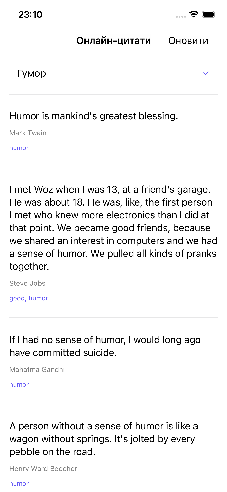
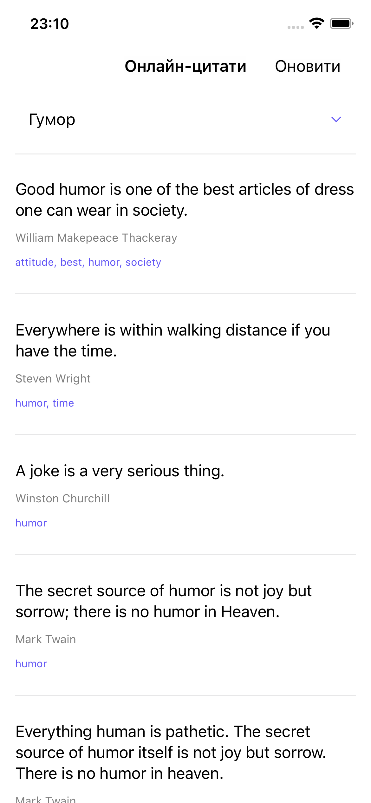
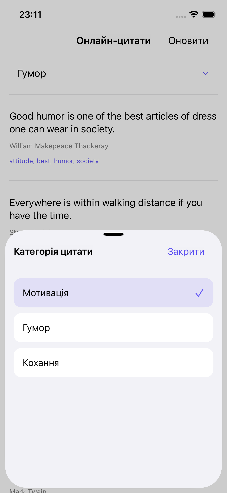
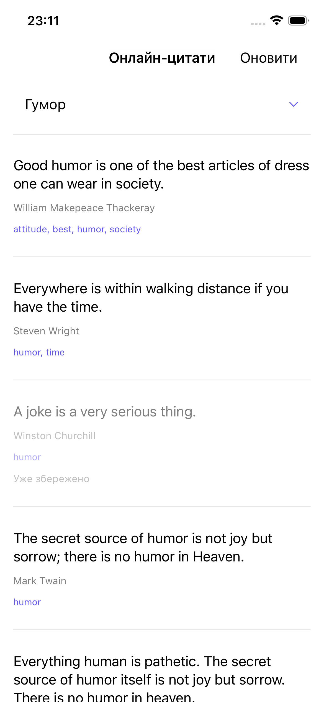
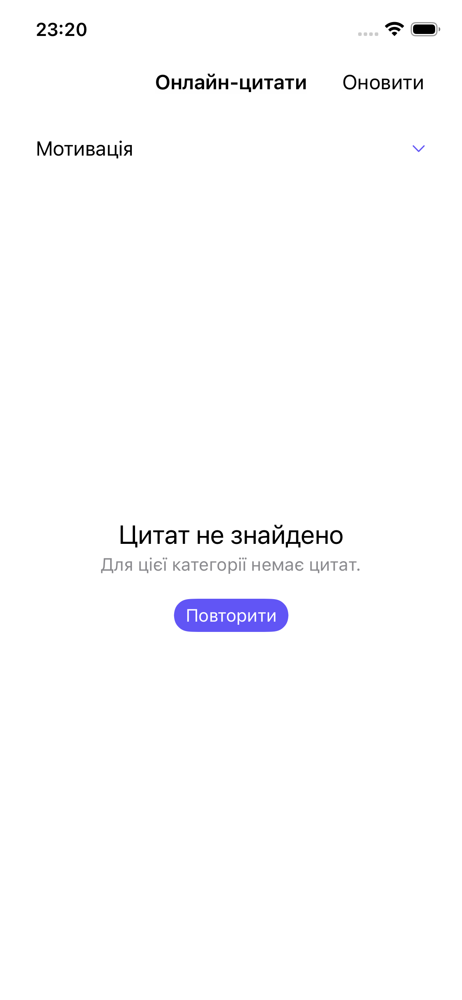
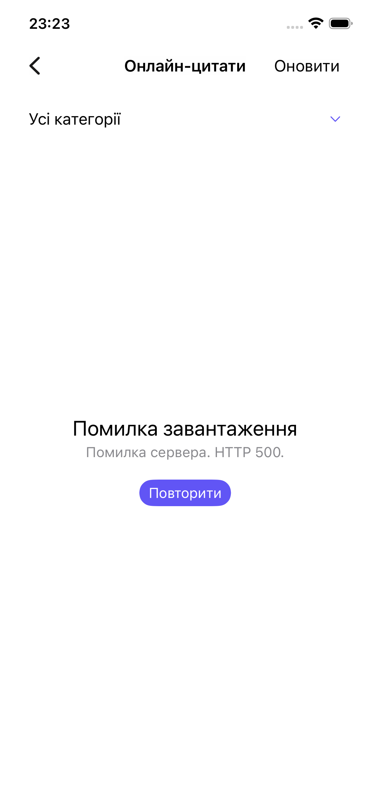

## Практична робота №4. Взаємодія із сервером та обробка даних

### Мета роботи

Реалізувати отримання даних із віддаленого сервера, використовуючи асинхронні HTTP-запити, типізоване декодування JSON та окремий мережевий компонент. Інтегрувати мережевий шар в архітектуру MVVM і забезпечити обробку основних станів та помилок.

### Джерело даних

Для застосунку QuotesApp обрано **FavQs API v3** - відкрите API для отримання цитат, їхніх авторів і тематичних категорій.

**Базова адреса:** https://favqs.com/api/v3  
**Метод запиту:** `GET`  
**Формат відповіді:** `JSON`  
**Авторизація:** для використаних публічних endpoint API-ключ не потрібен.

Використані endpoint:

| Endpoint | Призначення |
|---|---|
| `/quotes/popular` | Отримання популярних цитат |
| `/topics/motivation/quotes` | Мотиваційні цитати |
| `/topics/humor/quotes` | Гумористичні цитати |
| `/topics/love/quotes` | Цитати про кохання |

Параметри запиту:

- `limit=10` — максимальна кількість цитат на сторінці.
- `cursor` — курсор для отримання наступної сторінки.

Сервер може повертати менше цитат, ніж зазначено в `limit`.

### Організація мережевого шару

Мережева логіка відокремлена від інтерфейсу користувача.

| Компонент | Призначення |
|---|---|
| `RemoteQuote.swift` | Типізовані моделі JSON-відповіді |
| `QuoteAPIService.swift` | Протокол мережевого сервісу та типи помилок |
| `URLSessionQuoteAPIService.swift` | Виконання реальних HTTP-запитів |
| `MockQuoteAPIService.swift` | Імітація відповідей для тестування |
| `RemoteQuotesViewModel.swift` | Обробка отриманих даних і станів |
| `RemoteQuotesView.swift` | Відображення онлайн-цитат |

Мережевий сервіс використовує `URLSession` та механізм `async/await`. Отриманий JSON перетворюється у Swift-моделі за допомогою `Decodable` і `JSONDecoder`.

Модель `RemoteQuote` підтримує звичайні цитати та діалоги, представлені масивом `lines`.

### Інтеграція з MVVM

Для доступу до сервера використовується протокол `QuoteAPIService`.

Конкретна реалізація передається через **Dependency Injection** у `QuotesApp.swift`. Завдяки цьому реальний сервіс можна замінити тестовим без зміни ViewModel або інтерфейсу.

Схема взаємодії компонентів:

```text
RemoteQuotesView
       |
       v
RemoteQuotesViewModel
       |
       v
QuoteAPIService
       |
       +--- URLSessionQuoteAPIService
       |
       +--- MockQuoteAPIService
       |
       v
RemoteQuote / QuotesAPIResponse
```

`RemoteQuotesViewModel` позначена `@MainActor`, тому оновлення стану інтерфейсу виконується на головному акторі.

Асинхронні запити не блокують інтерфейс користувача.

### Сценарій роботи застосунку

FavQs використовується як **каталог для пошуку нових цитат**, а головний екран QuotesApp - як особиста колекція.

1. Користувач відкриває екран «Онлайн-цитати».
2. Вибирає категорію: «Усі», «Мотивація», «Гумор» або «Кохання».
3. Застосунок завантажує цитати з FavQs.
4. Із завантаженого набору випадково вибираються до п'яти цитат.
5. Натискання «Оновити» формує нову добірку.
6. За потреби наступні цитати завантажуються через `next_cursor`.
7. Натискання на цитату відкриває модальну панель вибору категорії.
8. Після вибору категорії цитата зберігається до локальної колекції.
9. Уже збережені цитати позначаються відповідним повідомленням, повторне збереження не допускається.

Випадкові добірки формуються із завантажених серверних цитат. До вичерпання доступного набору застосунок намагається уникати повторень.

**Локальні дані** зберігаються через `UserDefaultsQuoteAdapter`. Серверні цитати не додаються до особистої колекції автоматично.

#### Демонстрація роботи застосунку

**Головний екран QuotesApp із кнопкою переходу до онлайн-цитат**

<p align="center">
  
</p>

**Отримання цитат із FavQs API**

<p align="center">
  
</p>

**Оновлення випадкової добірки цитат**

<p align="center">
  
</p>

**Вибір категорії для збереження цитати**

<p align="center">
  
</p>

**Позначення вже збереженої цитати**

<p align="center">
  
</p>

**Відображення збереженої цитати в локальній колекції**

<p align="center">
  
</p>

### Стани завантаження

Для керування станом мережевого екрана реалізовано `LoadState`.

| Стан | Поведінка застосунку |
|---|---|
| `idle` | Початковий стан |
| `loading` | Відображення `ProgressView` |
| `success` | Відображення отриманих цитат |
| `empty` | Повідомлення про відсутність цитат |
| `failure` | Повідомлення про помилку та кнопка «Повторити» |

Зміна категорії ініціює нове завантаження. Для захисту від застарілих відповідей використовується ідентифікатор запиту.

### Обробка помилок

У `QuoteAPIError` передбачено окремі типи помилок:

| Помилка | Причина |
|---|---|
| `invalidURL` | Некоректна адреса запиту |
| `invalidResponse` | Некоректна HTTP-відповідь |
| `transport` | Помилка мережевого з'єднання |
| `httpStatus` | Невдалий HTTP-статус |
| `decoding` | Помилка декодування JSON |

Перед декодуванням перевіряється HTTP-статус відповіді. Успішними вважаються статуси `200...299`.

Також передбачено обробку скасування асинхронного завдання.

### Mock-сервіс і тестування

Для контрольованої перевірки негативних сценаріїв створено `MockQuoteAPIService`, що реалізує той самий протокол, що й реальний мережевий сервіс.

| Режим | Сценарій |
|---|---|
| `.empty` | Порожній список цитат |
| `.transportError` | Транспортна помилка |
| `.httpError` | HTTP 500 |
| `.decodingError` | Помилка декодування JSON |

Mock дозволяє перевірити, як застосунок реагує на відсутність даних і помилки, без необхідності викликати реальні відмови сервера.

Для кожного сценарію перевіряється відповідне повідомлення та можливість повторити запит.

### Інструкція запуску та перевірки

1. Відкрити `QuotesApp.xcodeproj` у Xcode.
2. Вибрати доступний симулятор iPhone.
3. Переконатися, що в `QuotesApp.swift` підключено `URLSessionQuoteAPIService()`.
4. Виконати `Product → Build`, потім `Product → Run`.
5. Відкрити екран «Онлайн-цитати».
6. Перевірити завантаження цитат із FavQs.
7. Перемкнути категорії та перевірити їхній вміст.
8. Натиснути «Оновити» для отримання іншої випадкової добірки.
9. Натиснути на цитату, вибрати категорію та зберегти її.
10. Повернутися на головний екран і перевірити наявність збереженої цитати.
11. Перезапустити застосунок і перевірити збереження локальних даних.

Для перевірки негативних сценаріїв у `QuotesApp.swift` тимчасово замінити реальний сервіс на потрібний режим `MockQuoteAPIService`.

Наприклад:

```swift
private let apiService: any QuoteAPIService =
    MockQuoteAPIService(mode: .empty)
```

Після завершення тестування повернути:

```swift
private let apiService: any QuoteAPIService =
    URLSessionQuoteAPIService()
```

Власний сервер для запуску не потрібен, оскільки застосунок використовує публічний FavQs API.

#### Демонстрація негативних сценаріїв

**Порожній результат — `MockQuoteAPIService(mode: .empty)`**

<p align="center">
  
</p>

**Помилка сервера HTTP 500 — `MockQuoteAPIService(mode: .httpError)`**

<p align="center">
  
</p>

### Розподіл роботи в команді (практична робота №4)

Проєкт розробляється трьома учасниками.

| Учасник | Зона відповідальності |
|---|---|
| ІА-41 Волошко Вікторія | Створення моделей для обробки JSON, реалізація протоколу мережевого сервісу, HTTP-запитів через URLSession, обробка мережевих помилок, розробка Mock-сервісу для тестування негативних сценаріїв |
| ІА-41 Гладун Варвара | Реалізація логіки отримання та обробки серверних цитат, керування станами завантаження, фільтрація за категоріями, формування випадкових добірок, кешування та пагінація |
| ІА-41 Заплітна Анна | Реалізація екрана онлайн-цитат, інтеграція FavQs API в застосунок, налаштування навігації та збереження цитат до локальної колекції, тестування інтерфейсу й Mock-сценаріїв, документація та GitHub |
