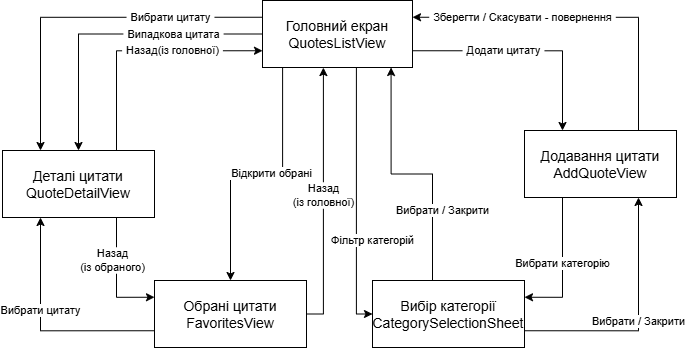
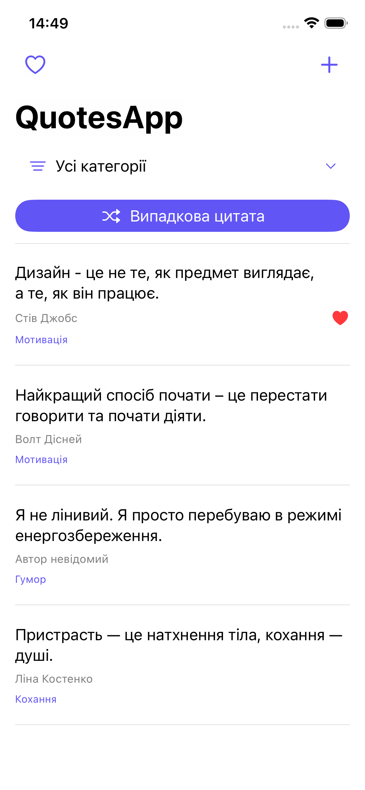
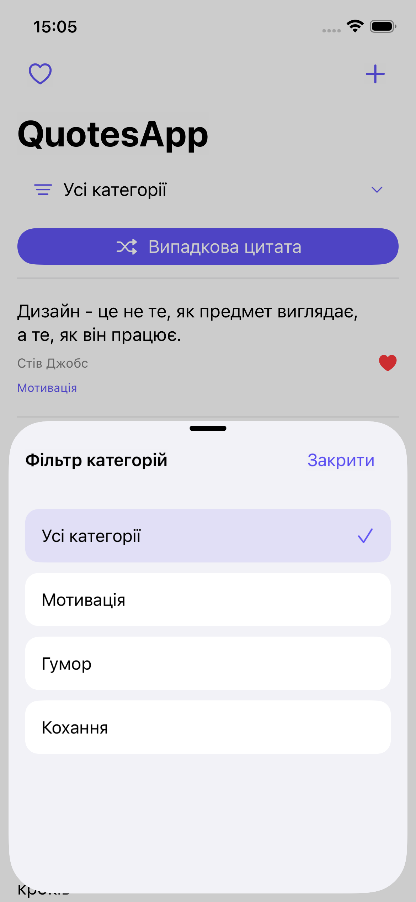
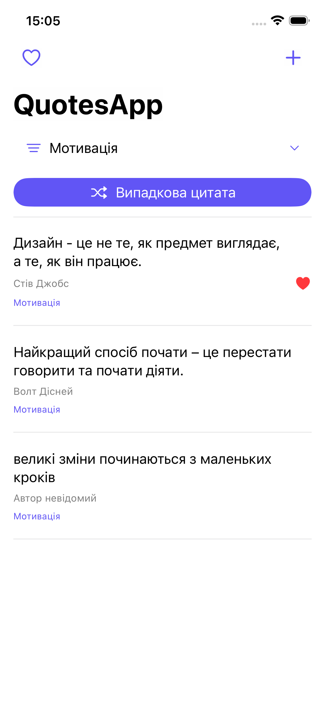
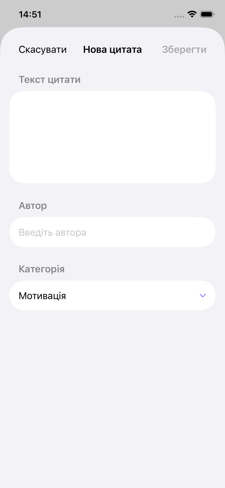
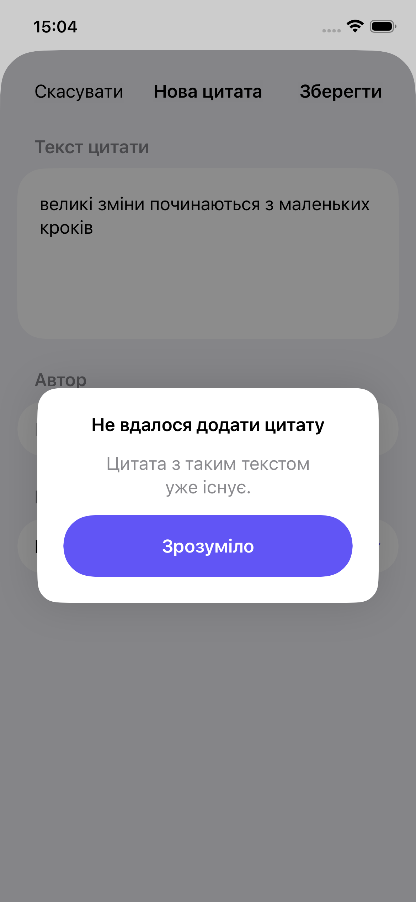

## Лабораторна робота №3. Навігація та інтерфейс користувача

### Мета роботи

Розробити повноцінний інтерфейс iOS-застосунку QuotesApp, реалізувати навігацію між екранами, передавання даних, модальну презентацію та анімацію елементів інтерфейсу.

## Реалізовані екрани

| Екран | Файл | Призначення |
|---|---|---|
| Головний екран | `QuotesListView.swift` | Відображення цитат, вибір категорії, генерація випадкової цитати |
| Деталі цитати | `QuoteDetailView.swift` | Перегляд тексту, автора, категорії та зміна статусу обраного |
| Обрані цитати | `FavoritesView.swift` | Перегляд цитат, доданих до обраного |
| Додавання цитати | `AddQuoteView.swift` | Створення власної цитати через модальну форму |

Додатково реалізовано `CategorySelectionSheet.swift` — спільний компонент вибору категорії для фільтрації та створення цитат.

## Організація навігації

Для керування навігацією використано `NavigationStack` та окремий компонент `AppRouter.swift`.
`AppRouter` відповідає за збереження стану навігації, відкриття екранів деталей та обраного, повернення до попередніх екранів і керування модальною формою додавання цитати.
Це дозволяє відокремити навігаційну логіку від інтерфейсу користувача.

### Карта навігації

  

## Передавання даних між екранами

Для відкриття деталей використовується маршрут `QuoteRoute.details(UUID)`.
Головний екран передає ідентифікатор вибраної цитати через `AppRouter`, після чого `QuoteDetailView` отримує відповідну цитату з `QuotesViewModel`.
Усі основні екрани використовують спільну ViewModel, тому зміни статусу обраного та додавання нових цитат відображаються без повторного запуску застосунку.

## Модальна презентація
Екран `AddQuoteView` відкривається модально за допомогою `.sheet`.
Користувач може ввести текст цитати, вказати автора та вибрати категорію. Перед збереженням перевіряється, чи не є текст порожнім і чи не існує цитата з таким текстом.
Після успішного додавання форма закривається, а список цитат оновлюється.

## Анімація

У `QuoteDetailView.swift` реалізовано анімацію кнопки обраного за допомогою `withAnimation` та `.spring()`.
Під час додавання або видалення цитати з обраного серце змінює свій стан і розмір із плавною анімацією.
Анімація пов'язана з конкретною дією користувача.

## Інструкція проходження сценарію

1. Запустити QuotesApp на iOS Simulator.
2. На головному екрані переглянути список готових цитат.
3. Вибрати категорію для фільтрації списку.
4. Відкрити деталі однієї із цитат.
5. Додати цитату до обраного.
6. Повернутися на головний екран та перейти до розділу «Обрані».
7. Перевірити наявність збереженої цитати.
8. Повернутися на головний екран.
9. Натиснути кнопку додавання цитати.
10. Ввести текст, автора, вибрати категорію та зберегти цитату.
11. Перевірити появу нової цитати у списку.
12. Скористатися функцією випадкової цитати та переглянути її деталі.

## Перевірка інтерфейсу

Інтерфейс потрібно перевірити на двох різних розмірах екрана iPhone.

Під час тестування перевіряються:

- Доступність елементів на головному екрані, у деталях та формах.
- Коректне відображення довгих цитат.
- Можливість прокручування форми з відкритою клавіатурою.
- Закриття клавіатури кнопкою «Готово».
- Доступність збереження після введення даних.
- Повторні переходи між екранами та повернення.
- Збереження цитат і статусу обраного після перезапуску застосунку.

### Скриншоти інтерфейсу

Інтерфейс застосунку QuotesApp протестовано на iPhone 16e.

#### 1. Головний екран та фільтрація цитат

  
  
  

#### 2. Перегляд деталей та керування обраним

  
  
  

#### 3. Список обраних цитат

  

#### 4. Додавання цитати та перевірка дублювання

  
  

## Розподіл роботи в команді (лабораторна робота №3)

Проєкт розробляється трьома учасниками.

| Учасник | Зона відповідальності |
|---|---|
| ІА-41 Волошко Вікторія | Підготовка початкових даних, реалізація екрана деталей цитати, додавання та видалення цитат з обраного |
| ІА-41 Гладун Варвара | Реалізація логіки застосунку, керування станом, додавання цитат, перевірка дублікатів, створення екрана обраних цитат |
| ІА-41 Заплітна Анна | Налаштування застосунку, реалізація навігації, головного екрана та вибору категорій, тестування інтерфейсу, документація та GitHub |
